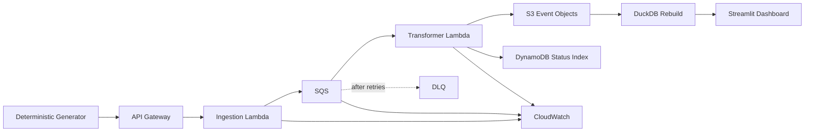
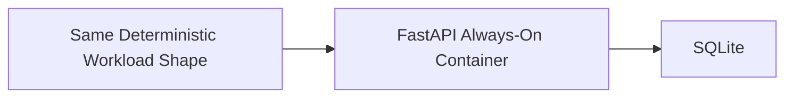

# Architecture and evidence flow

## Candidate serverless path

## Baseline path

## Evidence path

Raw request traces are written locally at request time. AWS state is then checked through DynamoDB/S3, operational metrics are collected from CloudWatch, negative tests produce JSON evidence contracts, and SHA-256 hashes are generated for the final package.
